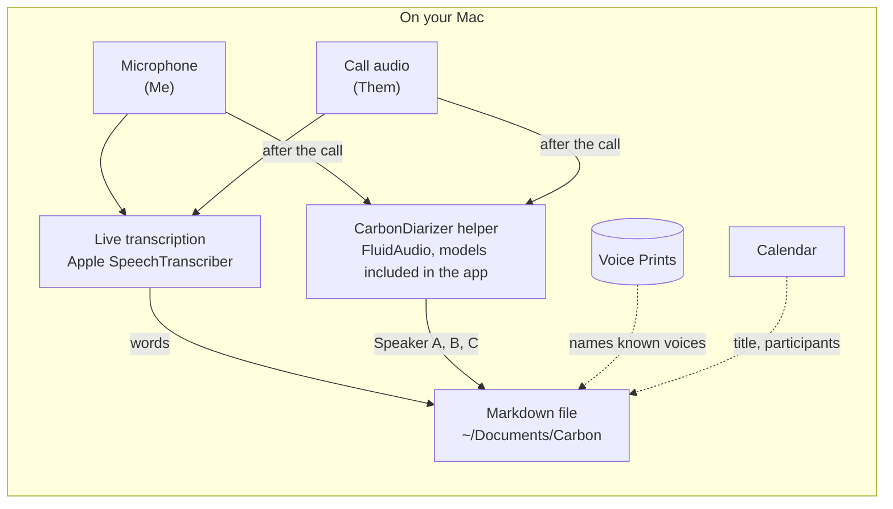

# Carbon

Meeting transcripts that stay on your Mac.

Carbon is a free, native macOS app that sits in your menu bar and turns every meeting into a Markdown file on your Mac, ready for any AI agent. No sign-in, no bot, no cloud.

**[Download Carbon for Mac](https://carbon.alexandrejoly.me/download)** · [carbon.alexandrejoly.me](https://carbon.alexandrejoly.me)

## Why

On a call you want to listen, not take notes. When it ends, what was decided and who said they'd do what is gone, unless you let a note taker bot into the call or upload the audio to someone's cloud.

I wanted the transcript without the bot, as a plain file I could hand to an AI agent, so I built Carbon.

## How it works

- **It starts on its own.** When Zoom, Google Meet, Teams, Webex, FaceTime or any other meeting app starts using your microphone, Carbon starts transcribing. A notification says so, and the dot in its menu bar icon stays red for the whole meeting. Stop on that notification discards everything.
- **It hears both sides.** Carbon records your microphone as "Me" and the call's audio as the other participants, and transcribes both on your Mac with Apple's SpeechTranscriber.
- **It tells voices apart.** The other participants become Speaker A, Speaker B, Speaker C. Name a speaker once and Carbon remembers their Voice Print, so it names them in later meetings. In a meeting room, where several people share your Mac's microphone, each voice in the room becomes its own Speaker too, and Carbon recognizes yours from the voice it learnt when you were alone at the mic. When it can't tell the voices apart, it falls back to Me and Them.
- **It names the meeting.** With calendar access, Carbon takes the title and participants from the matching event.
- **It files a Markdown file.** When the call ends, each meeting becomes one file in `~/Documents/Carbon`, organized by year. Press <kbd>⇧</kbd> <kbd>⌘</kbd> <kbd>C</kbd> to copy its path and paste it into Claude Code, Codex or whatever you use.

Everything in this diagram happens on your Mac:



Apple's SpeechTranscriber, built into macOS 26, writes the words as people speak. When the call ends, a small helper app inside Carbon, CarbonDiarizer, splits the other side's recorded audio into Speakers, and your microphone's too when several people in the room shared it. It uses [FluidAudio](https://github.com/FluidInference/FluidAudio), an open-source Swift library by Fluid Inference that runs speaker diarization models with Core ML. Those models were first published on Hugging Face under CC BY 4.0 and now ship inside Carbon, so diarization downloads nothing and your audio never leaves your Mac. For the little network traffic Carbon does make, see [Privacy](#privacy).

A meeting file looks like this:

```markdown
---
provider: Google Meet
id: 6F1C2B8E-0A51-4C3A-9E0B-1F2D3C4B5A61
date: 2026-10-27T10:00:00-04:00
title: Remote control kickoff
duration: 42:10
language: en-US
participants:
  - Dana Whitfield <dana@example.com>
  - Marcus Lee <marcus@example.com>
---

## Transcript

**Me** [0:00] Thanks for joining, let's get started with the remote control.

**Speaker A** [0:19] We met at the café last week and sketched the button layout.
```

Edit the file as you like. Carbon never rewrites your text: renaming a speaker or a meeting only touches the speaker labels or the title.

## Privacy

- Audio is processed only on your Mac, and deleted once the transcript is written, unless you turn on "Keep audio".
- Transcripts are plain files in a folder you choose. Voice Prints are numeric voice signatures stored only on your Mac, and you can delete them, or turn voice recognition off, in Settings.
- There's no account, no analytics and no server. The only network traffic is Sparkle checking for updates and Apple's own speech model downloads.

You're responsible for telling others they're being recorded.

## Install

Requires macOS 26 or later on a Mac with Apple silicon.

1. [Download the DMG](https://carbon.alexandrejoly.me/download). It's signed and notarized.
2. Drag Carbon to Applications and open it. It shows up in your menu bar.
3. Allow microphone, system audio recording and calendar access when macOS asks.

Carbon updates itself with [Sparkle](https://sparkle-project.org).

## Build from source

You need macOS 26 on Apple silicon, Xcode 26 and [XcodeGen](https://github.com/yonaskolb/XcodeGen). `Carbon.xcodeproj` is generated from `project.yml`.

```sh
brew install xcodegen
xcodegen generate
open Carbon.xcodeproj
```

Every rule and file format lives in the `CarbonCore` Swift package, which you can test without the app:

```sh
cd CarbonCore && swift test
```

The release pipeline's own pieces have their own tests: the appcast script in `scripts/release` (`python3 -m unittest`) and the download Worker in `worker/` (`npm ci && npm test`).

Try system audio capture from the built app, not from a terminal: launched from a terminal, Carbon's audio permission belongs to the terminal.

## Acknowledgements

Speaker diarization by [FluidAudio](https://github.com/FluidInference/FluidAudio). Its models ship inside Carbon (`App/DiarizationModels`): [Fluid Inference's Core ML conversion](https://huggingface.co/FluidInference/speaker-diarization-coreml) of pyannote's [speaker-diarization-community-1](https://huggingface.co/pyannote/speaker-diarization-community-1), modified for Apple platforms, with work by pyannote, WeSpeaker and BUT Speech@FIT. The models are licensed [CC BY 4.0](https://creativecommons.org/licenses/by/4.0/); see `App/DiarizationModels/speaker-diarization/NOTICE.md`.

## License

Carbon is released under the [MIT License](LICENSE). The bundled diarization models keep their own CC BY 4.0 licence, as noted above.
